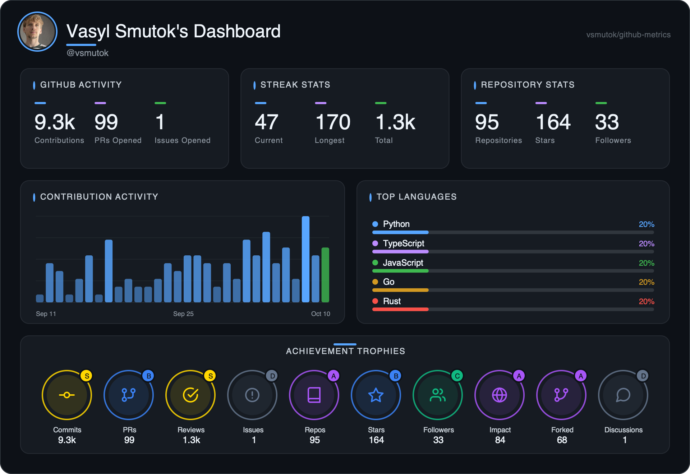
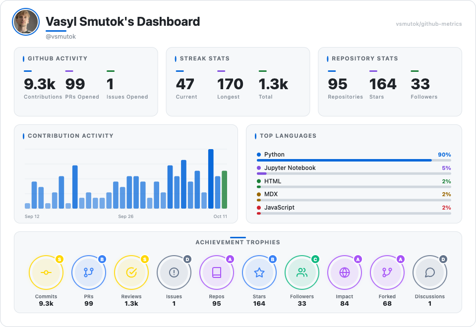
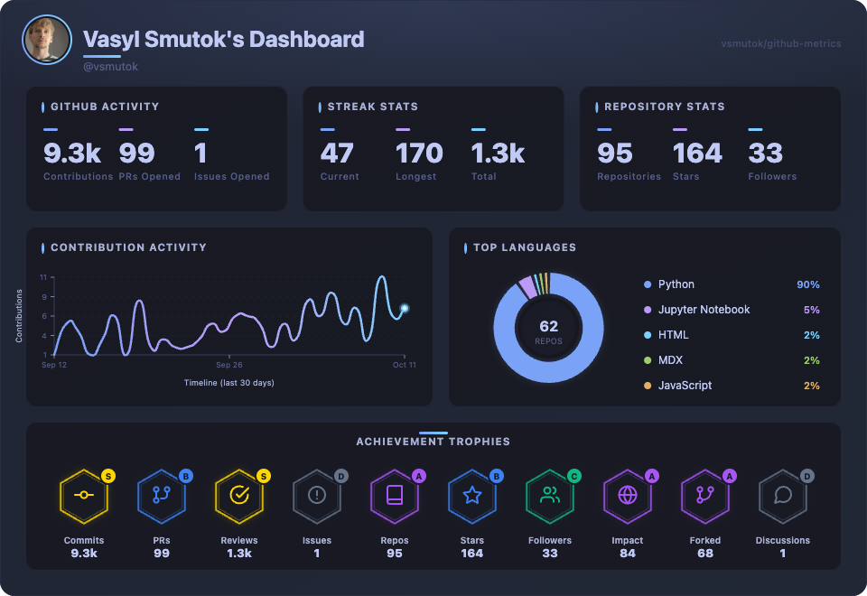
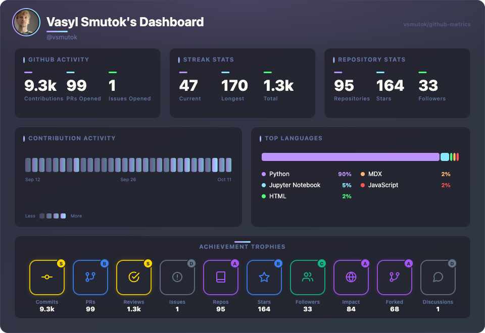
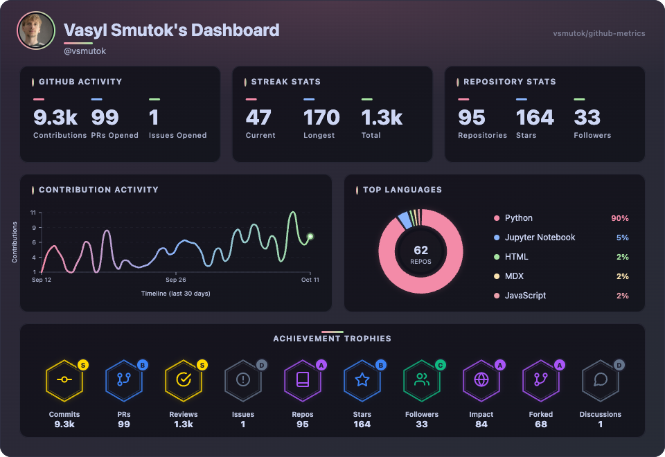
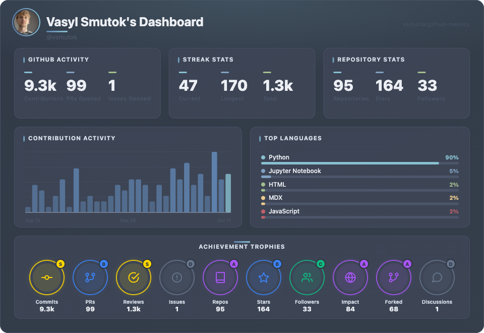
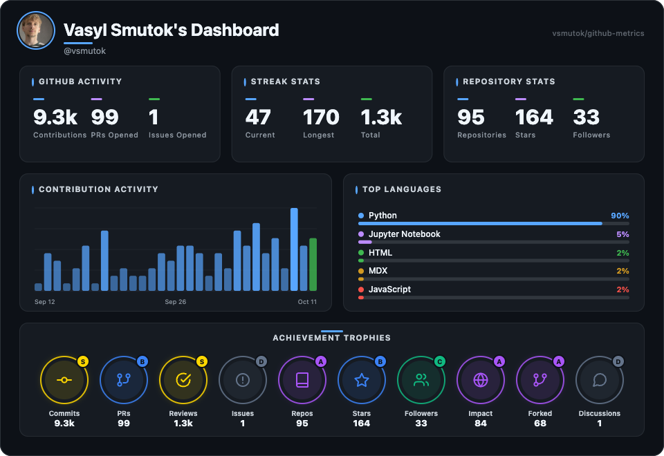

<p align="center">
  <a href="https://ghmetric.vercel.app/">
    
  </a>
</p>

<p align="center">
  <strong>One image. Your whole GitHub story.</strong><br>
  A live SVG card for your profile README — themes, charts, trophies, and competitive-programming stats. No widgets, no client scripts.
</p>

<p align="center">
  <a href="https://ghmetric.vercel.app/"></a>
  
  
  
</p>

<p align="center">
  <a href="https://ghmetric.vercel.app/">Open the studio</a>
  ·
  <a href="#embed-it">Embed in 30 seconds</a>
  ·
  <a href="#gallery">Gallery</a>
  ·
  <a href="#query-parameters">Parameters</a>
</p>

---

## Contents

- [Gallery](#gallery)
- [What it is](#what-it-is)
- [Embed it](#embed-it)
- [Themes](#themes)
- [Card styles](#card-styles)
- [Query parameters](#query-parameters)
- [Private repositories](#private-repositories)
- [Deployment](#deployment)
- [Run locally](#run-locally)
- [Contributing](#contributing)

---

## Gallery

The card is one SVG. Theme changes the palette. Style changes the charts and trophies. Hidden sections reflow — there are no empty gaps.

<table>
  <tr>
    <td align="center" width="50%">
      <br>
      <sub><code>theme=github-light</code> · classic</sub>
    </td>
    <td align="center" width="50%">
      <br>
      <sub><code>theme=tokyonight&style=modern</code></sub>
    </td>
  </tr>
  <tr>
    <td align="center">
      <br>
      <sub><code>theme=dracula&style=grid</code></sub>
    </td>
    <td align="center">
      <br>
      <sub><code>theme=catppuccin&style=modern</code></sub>
    </td>
  </tr>
  <tr>
    <td align="center">
      <br>
      <sub><code>theme=nord</code> · classic</sub>
    </td>
    <td align="center">
      <br>
      <sub><code>theme=github-dark</code> · default</sub>
    </td>
  </tr>
</table>

Tune username, theme, style and sections in the [interactive demo](https://ghmetric.vercel.app/), then copy the snippet.

---

## What it is

github-metrics turns a GitHub username into a single crisp SVG. Embed one ``. The card is regenerated on every view, cached in memory, and safe to drop into a profile README.

### Why github-metrics

- **One image, zero friction.** Nothing to add to your profile repo except a URL.
- **GitHub-native by default.** Ships GitHub's own palettes (`github-dark`, `github-light`, `github-dimmed`, high-contrast) and renders them flat.
- **32 themes** and **3 card styles** (Classic, Modern, Grid).
- **Every section is toggleable.** Hidden sections reflow, so there are no empty gaps.
- **More than GitHub.** LeetCode, Codeforces and CodeChef appear when at least two of those platforms return data.
- **Fast and accessible.** In-memory caching and WCAG-minded contrast checks.

### Sections

| Section | What it shows |
| :--- | :--- |
| GitHub activity | Contributions, pull requests opened, issues opened |
| Streak stats | Current streak, longest streak, total contribution days |
| Repository stats | Public repos, stars, forks and related repo totals. Hidden when a valid LeetCode profile is shown |
| Contribution chart | Last 30 days of contribution activity |
| Top languages | Language breakdown across public repositories |
| Achievement trophies | Commits, PRs, reviews, issues, repos, stars, followers, open-source impact, forks, discussions |
| Competitive programming | LeetCode, Codeforces and CodeChef — only when at least two platforms resolve |

---

## Embed it

Host the API (see [Deployment](#deployment)), then paste this into your profile `README.md`:

```md

```

A tighter card — modern style, centered header, no trophies:

```md

```

Boolean flags accept `true` / `false`, `1` / `0` and `yes` / `no`. Unknown themes and styles fall back to the defaults instead of failing the request.

### Static previews

The repo also ships pre-rendered SVGs (served statically by Vercel), one per theme:

```md

```

These are fixed (demo data). For your own live card, use the `/api/profile` endpoint above.

---

## Themes

Pass `?theme=` with any of these. The default is `github-dark`. `github` is an alias for `github-dark`; `high-contrast` is an alias for `hc-light`.

**GitHub** — `github-dark` · `github-light` · `github-dimmed` · `hc-dark` · `hc-light` · `dark` · `light`

**Editor** — `dracula` · `nord` · `monokai` · `gruvbox` · `tokyonight` · `solarized` · `catppuccin` · `rose-pine` · `onedarkpro` · `one-dark` · `material` · `cobalt2` · `androidstudio` · `xcode` · `oceanicnext`

**Atmosphere** — `aurora` · `midnight-sunset` · `synthwave84` · `forestnight` · `emberglow` · `midnightneon` · `pasteldream` · `webdev` · `aiml` · `gamedev`

Custom colors override any theme: `bg`, `text`, `accent`, `card_bg`, `border`, `sec_text`, `muted_text` (3- or 6-digit hex).

---

## Card styles

| Style | Look |
| :--- | :--- |
| `classic` | Bars, language bars, circular trophies. The default. |
| `modern` | Smoothed contribution line and a language donut. Hex trophies. |
| `grid` | Contribution heatmap and a stacked language bar. Squared trophies. |

---

## Query parameters

| Parameter | Type | Default | Description |
| :--- | :--- | :--- | :--- |
| `username` | string | `vsmutok` | Target GitHub username (`DEFAULT_USERNAME` overrides the built-in fallback) |
| `theme` | string | `github-dark` | Visual theme palette |
| `style` | string | `classic` | Card style: `classic`, `modern`, `grid` |
| `align` | string | `left` | Header alignment: `left`, `center`, `right` |
| `hide_header` | boolean | `false` | Hide the profile header |
| `hide_activity` | boolean | `false` | Hide the GitHub Activity card |
| `hide_streak` | boolean | `false` | Hide the Streak Stats card |
| `hide_repos` | boolean | `false` | Hide the Repository Stats card |
| `hide_contribution` | boolean | `false` | Hide the Contribution Activity chart |
| `hide_languages` | boolean | `false` | Hide the Top Languages chart |
| `hide_trophies` | boolean | `false` | Hide the Achievement Trophies row |
| `leetcode` | string | – | LeetCode username (solved + rating). Replaces repository stats when the profile loads |
| `codeforces` | string | – | Codeforces handle (rating + rank) |
| `codechef` | string | – | CodeChef username (rating, division, stars) |
| `bg`, `text`, `accent`, `card_bg`, `border`, `sec_text`, `muted_text` | hex | – | Custom color overrides |
| `user_key` | string | – | Opaque key that unlocks the connected account's private data. Added automatically by the studio |

Competitive-programming handles are optional. The CP row is drawn only when at least two of LeetCode, Codeforces and CodeChef return data. A single handle is ignored rather than leaving a half-empty row.

---

## Private repositories

By default cards only see public data. You can optionally let a card include **private repositories and private contributions** via GitHub OAuth — the same idea as the "Private Access" step in other stats engines.

How it works:

1. The studio generates a random `user_key` and stores it in your browser.
2. "Connect GitHub" sends you through GitHub's OAuth consent screen. The server exchanges the code for a token and stores it — encrypted with `TOKEN_ENCRYPTION_KEY` and keyed by `user_key`.
3. The studio appends `user_key` to the embed URL. When the card is rendered, the server loads the token and fetches your private repos and private contribution counts.

Security model:

- The token never reaches the browser or the card URL — only the opaque `user_key` does.
- A `user_key` is only honored when the `username` in the URL matches the account that granted it, so a shared card URL can't expose a different user's private data.
- Tokens are encrypted at rest (AES-256-GCM). Set a stable `TOKEN_ENCRYPTION_KEY`; rotating it invalidates existing connections.
- Because GitHub classic OAuth has no read-only private-repo scope, connecting requests the `repo` scope. Disconnecting revokes the authorization on GitHub and deletes the token.

Setup requires three environment variables plus storage (see below). Without them the feature stays hidden and the studio behaves exactly as before.

```text
GET /api/auth/status            # { enabled, persistent, encrypted }
GET /api/auth/login?user_key=…  # redirect to GitHub
GET /api/auth/callback          # OAuth redirect target
GET /api/auth/session?user_key=… # { enabled, authenticated, login, privateAccess }
POST /api/auth/logout?user_key=… # revoke + forget
```

---

## Deployment

The app is a small Express server that renders SVG on demand. It runs without a token: a public fallback fills contributions and streaks. A token improves accuracy (PRs, issues, reviews) and raises GitHub rate limits.

### Vercel — API + demo, auto-deploy

1. Import the repo at [vercel.com/new](https://vercel.com/new). The included `vercel.json` serves the demo from `public/` and the API as a serverless function.
2. In **Project → Settings → Environment Variables**, add `GITHUB_TOKEN` (create one [here](https://github.com/settings/tokens); no extra scopes needed for public data).
3. Deploy. Every push to `main` re-deploys automatically.

Your embed URL is then:

```md

```

### Other hosts

Prefer to run it yourself? Docker works anywhere:

```bash
docker compose up -d
```

See the [`Dockerfile`](Dockerfile). `npm start` builds the renderer bundle, then listens on `PORT` (default `3000`). Use `GET /health` as the liveness probe.

---

## Run locally

Requires Node.js 20 or newer.

```bash
git clone https://github.com/vsmutok/github-metrics.git
cd github-metrics
npm install
cp .env.example .env      # optional, but recommended
npm run dev               # http://localhost:3000
```

Open the demo at <http://localhost:3000>, or request a card directly:

```text
http://localhost:3000/api/profile?username=YOUR_USERNAME
```

### Environment

Copy [`.env.example`](.env.example). Every variable is optional.

| Variable | Default | Purpose |
| :--- | :--- | :--- |
| `PORT` | `3000` | HTTP port |
| `NODE_ENV` | `development` | `development` or `production` |
| `GITHUB_TOKEN` | – | Public-scope token. Higher rate limits and more accurate PR / issue / review stats. [Create one](https://github.com/settings/tokens) with no extra scopes |
| `DEFAULT_USERNAME` | `vsmutok` | Used when `?username` is omitted |
| `CACHE_MAX_SIZE` | `1000` | In-memory cache entries. TTL is 5 minutes in development and 30 minutes in production |
| `MONGODB_URI` | – | MongoDB connection. Enables analytics and persistent OAuth token storage |
| `MONGODB_DB` | from the URI | Database name override |
| `ANALYTICS_DISABLED` | – | Set to `true` to skip logging even when MongoDB is configured |
| `ADMIN_API_KEY` | – | When set, `GET /api/cache/stats` requires this key. When unset, cache stats are public |
| `GITHUB_OAUTH_CLIENT_ID` | – | OAuth App client ID. Enables private-repo access |
| `GITHUB_OAUTH_CLIENT_SECRET` | – | OAuth App client secret |
| `GITHUB_OAUTH_REDIRECT_URI` | – | Must match the OAuth App callback, e.g. `https://your-domain/api/auth/callback` |
| `TOKEN_ENCRYPTION_KEY` | – | Long random secret used to encrypt stored tokens. Keep it stable (`openssl rand -hex 32`) |

### Scripts

| Command | What it does |
| :--- | :--- |
| `npm run dev` | Watch mode (`node --watch`) |
| `npm start` | Production server |
| `npm test` | Unit tests |
| `npm run test:coverage` | Coverage report |
| `npm run test:visual` | Visual workflow tests |
| `npm run check` | Lint / quality gate |
| `npm run previews` | Rebuild static theme SVGs |
| `npm run build:previews` | Bundle the engine and regenerate previews |

### API endpoints

| Endpoint | Description |
| :--- | :--- |
| `GET /api/profile` | Dashboard SVG for a username |
| `GET /api/profile/loading` | Loading spinner SVG (honors `theme` and color overrides) |
| `GET /api/theme-preview/:theme` | Mock dashboard preview for a theme |
| `GET /api/auth/*` | GitHub OAuth flow for private-repo access (see [Private repositories](#private-repositories)) |
| `GET /health` | Liveness probe |
| `GET /api/cache/stats` | Cache statistics. Protected when `ADMIN_API_KEY` is set |

### Project structure

```text
src/
├── routes/       # Express routes
├── services/     # GitHub, LeetCode, Codeforces, CodeChef
├── renderers/    # SVG dashboard renderer
├── themes/       # Color palettes
├── utils/        # Cache, validation, sanitizers, accessibility
└── server.js     # Express entry point
public/           # Interactive demo and README photos
previews/         # Static theme SVGs
```

---

## Contributing

Contributions are welcome — bug fixes, themes, docs and renderer work. See [CONTRIBUTING.md](CONTRIBUTING.md) and the [Code of Conduct](CODE_OF_CONDUCT.md).

Security issues and SVG injection reports should go to the maintainers privately, not to a public issue.

## License

[MIT](LICENSE) © vsmutok.
